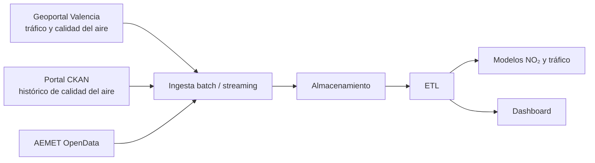

# Proyecto 4 · Big Data urbano (Valencia)

> Proyecto del módulo **Big Data aplicado** (IABD). Pipeline batch + streaming sobre datos abiertos de tráfico, calidad del aire y meteorología de Valencia (Geoportal, portal CKAN del Ayuntamiento y AEMET), con modelos predictivos de NO₂ y de tráfico.

## Descripción y objetivo

Recoger con regularidad los datos abiertos urbanos de Valencia (tráfico, calidad del aire y meteorología), guardar su histórico y usarlo para predecir el NO₂ y la intensidad del tráfico.

## Arquitectura



*Diagrama provisional (Bloque 0). Se actualizará al terminar cada bloque.*

## Fuentes de datos

| Fuente | URL / origen | Formato | Frecuencia de actualización | Licencia | Última ingesta |
|---|---|---|---|---|---|
| Calidad del aire (tiempo real) | Geoportal del Ayuntamiento de Valencia | JSON | Cada hora | CC BY 4.0 | — |
| Tráfico (tiempo real) | Geoportal del Ayuntamiento de Valencia | JSON | Cada pocos minutos | CC BY 4.0 | — |
| Calidad del aire (histórico) | Portal de datos abiertos (CKAN) de Valencia | CSV | Única | CC BY 4.0 | — |
| Predicción y observación meteorológica | AEMET OpenData (API key en `.env`) | JSON | Diaria / horaria | Aviso legal de AEMET | — |

## Estructura del repositorio

| Carpeta | Contenido |
|---|---|
| `ingesta/` | Recolectores de datos abiertos |
| `etl/` | Transformaciones y limpieza |
| `dashboard/` | Paneles de visualización |
| `scripts/` | Scripts sueltos (por ahora, la descarga de la predicción de AEMET para Paterna) |
| `docs/` | Capturas y diagramas |
| `data/` | Datos descargados (fuera de Git) |

## Cómo desplegar el entorno

```bash
python -m venv .venv && source .venv/bin/activate
pip install requests python-dotenv
echo "AEMET_API_KEY=<tu clave>" > .env   # la clave no se sube nunca
python scripts/descargar_prediciones.py
```

## Bitácora de prácticas

### Bloque 0 · Entorno

- Objetivo: dejar preparado el repositorio con la estructura del módulo.
- Pasos realizados: creación del repo, carpetas `ingesta/`, `etl/`, `dashboard/` y `docs/`, `.gitignore` del módulo (con `.env` y `data/` fuera de Git), README inicial y publicación en GitHub.
- Problemas encontrados y solución: Git no versiona carpetas vacías; se añade un `.gitkeep` en cada una para que aparezcan en GitHub.
- Resultado: repositorio publicado.

### Bloque 1 · Ingesta batch

- Objetivo: —
- Pasos realizados: —
- Problemas encontrados y solución: —
- Resultado: —

## Decisiones técnicas

| Decisión | Alternativa descartada | Motivo |
|---|---|---|
| La API key de AEMET en `.env`, fuera de Git | Escribirla en el script | No se publica ninguna credencial en el repositorio |

## Incidencias resueltas

*Ninguna por ahora.*
