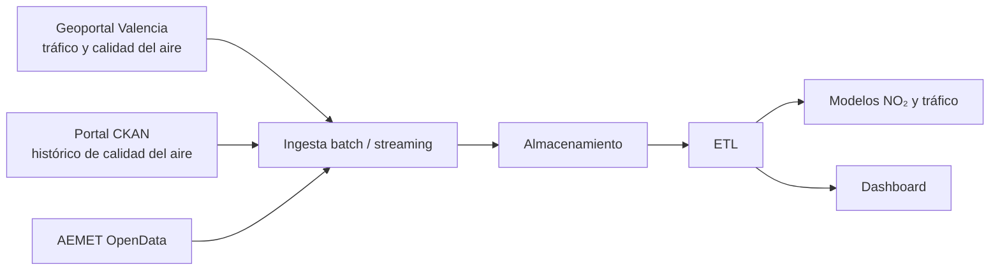
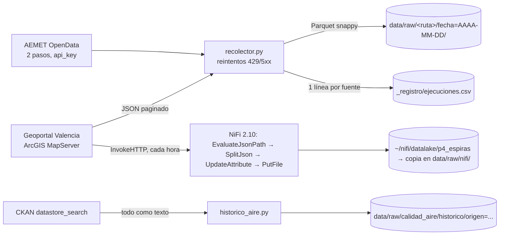

# Proyecto 4 · Big Data urbano (Valencia)

> Proyecto del módulo **Big Data aplicado** (IABD). Pipeline batch + streaming sobre datos abiertos de tráfico, calidad del aire y meteorología de Valencia (Geoportal, portal CKAN del Ayuntamiento y AEMET), con modelos predictivos de NO₂ y de tráfico.

## Descripción y objetivo

Recoger con regularidad los datos abiertos urbanos de Valencia (tráfico, calidad del aire y meteorología), guardar su histórico y usarlo para predecir el NO₂ y la intensidad del tráfico.

## Arquitectura



*Diagrama provisional (Bloque 0). Se actualizará al terminar cada bloque.*

## Fuentes de datos

| Fuente | URL / origen | Formato | Frecuencia de actualización | Licencia | Última ingesta |
|---|---|---|---|---|---|
| Calidad del aire (tiempo real) | Geoportal del Ayuntamiento de Valencia | JSON | Cada hora | CC BY 4.0 | — |
| Tráfico (tiempo real) | Geoportal del Ayuntamiento de Valencia | JSON | Cada pocos minutos | CC BY 4.0 | — |
| Calidad del aire (histórico) | Portal de datos abiertos (CKAN) de Valencia | CSV | Única | CC BY 4.0 | — |
| Predicción y observación meteorológica | AEMET OpenData (API key en `.env`) | JSON | Diaria / horaria | Aviso legal de AEMET | — |

## Estructura del repositorio

| Carpeta | Contenido |
|---|---|
| `ingesta/` | Recolectores de datos abiertos |
| `etl/` | Transformaciones y limpieza |
| `dashboard/` | Paneles de visualización |
| `scripts/` | Scripts sueltos (por ahora, la descarga de la predicción de AEMET para Paterna) |
| `docs/` | Capturas y diagramas |
| `data/` | Datos descargados (fuera de Git) |

## Cómo desplegar el entorno

```bash
python -m venv .venv && source .venv/bin/activate
pip install requests python-dotenv
echo "AEMET_API_KEY=<tu clave>" > .env   # la clave no se sube nunca
python scripts/descargar_prediciones.py
```

## Bitácora de prácticas

### Bloque 0 · Entorno

- Objetivo: dejar preparado el repositorio con la estructura del módulo.
- Pasos realizados: creación del repo, carpetas `ingesta/`, `etl/`, `dashboard/` y `docs/`, `.gitignore` del módulo (con `.env` y `data/` fuera de Git), README inicial y publicación en GitHub.
- Problemas encontrados y solución: Git no versiona carpetas vacías; se añade un `.gitkeep` en cada una para que aparezcan en GitHub.
- Resultado: repositorio publicado.

### Bloque 1 · Ingesta batch

- Objetivo: construir la ingesta batch de datos abiertos urbanos de Valencia (tráfico, calidad del aire y meteorología): un recolector en Python que guarda una «foto» por fuente en Parquet, la carga única del histórico de aire 2016–2022 y, como ampliación, la captura de espiras reproducida con Apache NiFi.

#### Fuentes de datos

| Fuente | Endpoint | Clave | Frecuencia en origen | Histórico | Filas por captura |
|---|---|---|---|---|---|
| Espiras de tráfico | Geoportal `Trafico/MapServer/208` | No | Cada hora | No: hay que acumular capturas | 1211 |
| Tramos de tráfico | Geoportal `Trafico/MapServer/188` | No | Tiempo real | No | 394 |
| Estado del tráfico | Geoportal `Trafico/MapServer/192` | No | Cada 3 min | No | 462 |
| Calidad del aire (estaciones) | Geoportal `MedioAmbiente/MapServer/156` | No | Horaria | No (el histórico está en CKAN) | 11 |
| Meteorología municipal | Geoportal `MedioAmbiente/MapServer/157` | No | Horaria | No | 5 |
| Predicción AEMET | `prediccion/especifica/municipio/diaria/46250` (dos pasos) | Sí (`AEMET_API_KEY`) | Diaria | No | 7 (una por día pronosticado) |
| Observación AEMET | `observacion/convencional/datos/estacion/8416` (dos pasos) | Sí | Horaria | Últimas ~24 h por llamada | 13 |
| Histórico de aire 2016–2021 | CKAN `opendata.vlci.valencia.es`, recurso `4be7248b-9597-4017-89af-82a9b6e2382f` | No | Carga única | Sí | 449.026 |
| Histórico de aire 2021–2022 | CKAN, recurso `19b5a1a7-5888-4d3e-b69b-3c1436d64e6e` | No | Carga única | Sí | 201.480 |

#### Diagrama de la ingesta



#### Recolector y registro

`recolector/recolector.py` se lanza con `python recolector.py espiras tramos estado aire meteo aemet aemet_obs`. Cada fuente se ejecuta por separado: si una falla, queda registrada con `ok=0` y el mensaje de error en `data/raw/_registro/ejecuciones.csv` (`captura_utc,fuente,ok,filas,error`) y las demás siguen. Los reintentos (hasta 5, con espera creciente y respeto de `Retry-After`) cubren errores de red, 429 y 5xx. La clave de AEMET se lee de `.env`, que no se sube a Git. Pruebas: `.venv/bin/python -m pytest -q recolector` (6 pasan).

#### Programación con `cron`

La práctica se hace en el portátil, que no está siempre encendido, así que **no hay ninguna tarea permanente instalada**. `recolector/cron_demo.sh` muestra la crontab que se usaría en un servidor y ejecuta una vez el recolector en un entorno vacío (`env -i`, `PATH` mínimo), igual que lo haría cron. La salida está en `docs/evidencia_cron.txt` y en `logs/cron.log`.

| Fuente | Cron | Justificación |
|---|---|---|
| espiras | `0 * * * *` | El conteo se refresca cada hora; capturar más a menudo duplicaría filas |
| tramos | `*/15 * * * *` | El estado del tráfico cambia rápido y es la serie que no existe en origen |
| estado | `*/15 * * * *` | Se actualiza cada 3 min; cada 15 min equilibra huecos y volumen |
| aire | `10 * * * *` | Dato horario; el minuto 10 deja margen a que se publique |
| meteo | `20 * * * *` | Dato horario; desplazado para no coincidir con las demás |
| aemet | `30 6 * * *` | La predicción se publica de madrugada y es diaria |
| aemet_obs | `0 */6 * * *` | Cada llamada devuelve ~24 h, así que 6 h solapa sin perder datos y cuida la cuota |

#### Histórico de aire 2016–2022

`ingesta/historico_aire.py` pagina `datastore_search` (10.000 filas por página), guarda **todos los valores como texto** tal cual vienen y normaliza solo los nombres de columna (minúsculas, sin tildes, `PM2.5` → `pm2_5`). Si el origen ya existe no repite la descarga salvo con `--forzar`. Las filas descargadas coinciden con el `total` de CKAN en los dos orígenes (449.026 y 201.480). 13 pruebas.

#### Ampliación: espiras con Apache NiFi

NiFi 2.10.0 en Docker, **reutilizando el contenedor `bigdata-nifi` que ya existía** (proyecto `~/nifi`; `docker-compose.yml` lo documenta, no lo recrea). El flujo, en su propio grupo de proceso, es InvokeHTTP → EvaluateJsonPath → SplitJson → UpdateAttribute → PutFile (se añadió UpdateAttribute porque PutFile no tiene propiedad de nombre). Se creó con `nifi/crear_flujo.py` (API REST) y se exportó a `nifi/flujo_espiras.json`. Como el contenedor solo monta `~/nifi/datalake`, PutFile escribe en `/datalake/p4_espiras` y los ficheros se copian a `data/raw/nifi/` (fuera de Git). Prueba real: 6 descargas × 1211 puntos = 7.266 ficheros. Capturas: `docs/nifi/nifi_flujo.png` y `docs/nifi/nifi_provenance.png`. Más detalle en `nifi/NOTAS.md`.

| Aspecto | Recolector Python | Flujo NiFi |
|---|---|---|
| Tiempo de desarrollo | Unos 2 min para el equivalente de espiras | Unos 12 min la primera vez (5 depurando TLS en NiFi 1.28); adaptarlo a 2.10 y llegar a los primeros ficheros, unos 3,5 min |
| Facilidad para depurar un fallo | Traza y log en el terminal; se repite en local | Bulletins por procesador, colas inspeccionables y un embudo de errores; en contra, un nombre de propiedad mal escrito no da error y los nombres cambian entre versiones |
| Visibilidad del estado en ejecución | Hay que leer `ejecuciones.csv` y los logs | Contadores, colas y Data Provenance de cada flowfile en la interfaz |
| Facilidad de versionado en Git | Un `.py` de pocas líneas, diff legible | JSON exportado de 39 KB, sin secretos; los diffs son poco legibles |
| Recursos necesarios en el servidor | ~27 MB de RAM y 0,8 s por descarga | 1,37–1,46 GiB de RAM (1,72 GiB tras usar la UI), imagen de 1,30 GB y 25,6 s de arranque |

#### Problemas encontrados y solución

- **Columnas totalmente nulas** (`hora_actualizacion`, `fiwareid` en espiras; `observaciones` en tramos): Parquet las guarda con tipo `null`, que Spark puede rechazar; se convertirán a texto en el Bloque 4.
- **Fechas de ArcGIS** en epoch de milisegundos y `tramos.idtramo` como texto frente a `estado.idtramo` como entero: se normalizan en el ETL.
- **AEMET:** el `id` del municipio llega como `-19286` y el nombre como «València», no 46250; `elaborado` cambia en cada llamada y sirve para detectar duplicados. En las ejecuciones no hubo errores 429.
- **Histórico de aire:** `fecha` es `YYYY-MM-DDTHH:MM:SS` en 2016–2021 y `YYYY-MM-DD` en 2021–2022; la `hora` tiene cuatro formatos (`HH:MM:SS`, `H:MM:SS`, `HH:MM`, `H:MM`); los dos orígenes se solapan en 2021; y en una muestra `dia_del_mes` parece traer el mes. No se ha tocado nada: se arregla en el Bloque 4.
- **NiFi y TLS:** `geoportal.valencia.es` está firmado por la raíz `ACCVRAIZ1`. En NiFi 1.28 el Java no la tenía y falló con `PKIX path building failed`; en la imagen 2.10 el Java ya confía en ella, así que no hace falta truststore.
- **Contenedor:** se reutiliza `bigdata-nifi` (NiFi 2.10, otro ejercicio del equipo); no se ha recreado ni tocado su otro flujo. La zona horaria del contenedor es UTC, por lo que los nombres de fichero fuerzan `Europe/Madrid`.

- Resultado: recolector probado con las 7 fuentes en verde, histórico cargado y verificado, y flujo NiFi ejecutado y exportado. **Evidencia de cron:** ejecución única, no una recogida de un día completo.

## Decisiones técnicas

| Decisión | Alternativa descartada | Motivo |
|---|---|---|
| La API key de AEMET en `.env`, fuera de Git | Escribirla en el script | No se publica ninguna credencial en el repositorio |

## Incidencias resueltas

*Ninguna por ahora.*
